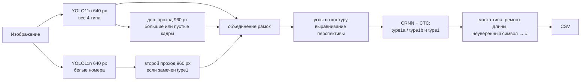

# Пояснительная записка: распознавание нестандартных ГРЗ

Решение принимает каталог изображений и пишет CSV `image;plate_num;plate_type;confidence`. Оно работает офлайн и запускается одной командой ([README.md](README.md)). На 89 новых номерах, которые не использовались ни для обучения, ни для подбора настроек, целиком прочитан 51 номер (57 %). Ни один номер `other` не выдан как `type1`. Среднее время — 22,5 мс на RTX 3060; для GTX 1050 Ti дана оценка 55–85 мс. Подробности обучения, всех версий и экспериментов — в [TECHNICAL_DETAILS.md](TECHNICAL_DETAILS.md).

| Качество: номер верен, если совпали все символы и тип | `type1` | `type1a` | `type1b` | `other` не выдан как `type1` | всего |
|---|---:|---:|---:|---:|---:|
| fin_test, 72 новых фото ([отчёт](fin_test_report_v8.json)) | 9/14 | 11/21 | 13/22 | 16/16 фото | 33/57 |
| test22, 32 новых фото ([отчёт](test22_report_v8_sub.json)) | — | 18/32 | — | — | 18/32 |
| **Новые фото вместе** | **9/14** | **29/53** | **13/22** | **16/16** | **51/89 (57 %)** |
| val, 91 фото, *использовался для выбора моделей и порогов* ([отчёт](detection_variants_V6_2048.json)) | — | 19/27 | 47/63 | 8/8 фото | 66/90 |

Обе новые проверки запущены по одному разу, после всех решений. На 89 номерах разброс оценки около ±10 %. В test22 23 разные машины, часть из них встречается на 2–4 фото.

## 1. Источники данных

Реальная часть — 606 изображений, 641 номер. Источник и лицензия каждого изображения записаны в `meta.csv` и `rights_provenance.json` датасета.

| Источник | Изображений | Условия |
|---|---:|---|
| сообщества ВКонтакте | 261 | письменные разрешения авторов на CC BY 4.0 (`dataset/evidence/`) |
| Wikimedia Commons | 106 | лицензия источника (CC BY / CC BY-SA) |
| Roboflow Universe, «Russian License Plates Detector» (RU ANRP) | 100 | CC BY 4.0 |
| Flickr | 86 | лицензия источника (CC BY 2.0 и др.) |
| собственные фото участника | 35 | собственные |
| busphoto.eu | 13 | указано в `meta.csv` |
| Unsplash | 5 | Unsplash License |

По лицензиям: 407 изображений под CC BY 4.0, 94 под CC BY 2.0. 59 фото (49 CC BY-SA, 5 Unsplash, 5 с разрешением автора только для проекта) и 387 синтетических кадров на их основе перечислены в `dataset/license_exceptions.csv` и могут быть исключены. Отладочный набор организаторов в датасет не включён.

| Состав датасета | `type1` | `type1a` | `type1b` | `other` | всего |
|---|---:|---:|---:|---:|---:|
| Реальные изображения | 100 | 151 | 302 | 53 | 606 |
| Реальные номера | 100 | 151 | 334 | 56 | 641 |
| Уникальные номера | 98 | 87 | 275 | 53 | |
| train / val / test, изображения | 100 / 0 / 0 | 102 / 27 / 22 | 184 / 56 / 62 | 38 / 8 / 7 | 424 / 91 / 91 |
| Синтетические номера (5000 изображений) | 900 | 1900 | 2082 | 323 | 5205 |

## 2. Методика сбора и генерации

**Сбор реальных фото.** Использовались собственная съёмка, открытые источники с лицензией, допускающей некоммерческое использование, и разрешения авторов. Дубликаты отсеяны по SHA256 и перцептивному хешу. Разбиение 424 / 91 / 91 ([splits/real606.json](splits/real606.json)) сделано так, что фото одного номера попадают только в одну часть.

**Разметка.** Рамка, четыре угла по часовой стрелке, тип, текст, `is_vehicle` и условия съёмки размечены вручную и проверены глазами. Чужая модель для автоматической разметки не применялась. Нечитаемые позиции отмечены `#`.

**Приватность.** Лица на всех кадрах размыты ([blur_people.py](blur_people.py)). Кадры, где человек — смысловой центр, не включались.

**Синтетика.** 5000 изображений строятся только на обучающих фото. На место номера наносится новый текст по маске типа, перспектива и освещение исходного кадра сохраняются. Генератор лежит в `dataset/generator/` и воспроизводится с фиксированным seed 20261023. Для OCR дополнительно используется процедурная синтетика ([alpr/synth_crops.py](alpr/synth_crops.py)). Номер рисуется целиком и ставится в случайную сцену с поворотом до 12° и перспективой, затем кадр портится экспозицией, тенью, смазом, шумом и JPEG. Фото при этом не используются.

**Проверка датасета.** Структура соответствует разделу 6 задания. Отчёт валидатора — [dataset_validation_report.json](dataset_validation_report.json): ошибок нет. Это локальный валидатор; официальный `validate_dataset.py` нужно прогнать дополнительно.

## 3. Обоснование архитектуры

- **Детекция.** Работают два YOLO11n. Основной находит все четыре типа. Второй дообучен на белых номерах и повышает полноту `type1`/`type1a`. Номера `other` детектор относит к отдельному классу и в CSV не выводит, поэтому они не выдаются как `type1`. Дополнительный проход основного детектора на 960 px запускается на крупных кадрах и на кадрах без найденных рамок. На val он нашёл 6 из 12 ранее пропущенных номеров.
- **Выравнивание.** Внутри рамки ищется четырёхугольный контур номера и исправляется перспектива. Квадратный номер разворачивается в строку «верхняя строка + нижняя строка».
- **Чтение.** Используется CRNN (свёрточная сеть + GRU) с обучением по CTC. Тип номера задаёт допустимую длину и класс символа на каждой позиции. Символ с уверенностью ниже порога (0.40, для `type1` 0.5) заменяется на `#`. Если строка ровно на один символ длиннее маски, удаляется наименее уверенный символ.
- **Почему так.** Главная трудность задачи — мало реальных примеров редких типов, а не архитектура. Лёгкие модели быстро дообучаются на сотнях фото и синтетике и укладываются в бюджет GTX 1050 Ti. Тип отделён от чтения, поэтому новый формат добавляется данными и маской, без смены пайплайна (раздел 6).
- **Обучение.** Детекторы — YOLO11n с весов COCO на 424 реальных фото. OCR — реальные обрезки и два раунда процедурной синтетики: точность на обрезках val выросла с 50 % до 67 %. Чекпойнты и пороги выбирались только по val. Команды обучения записаны в `MODEL_PROVENANCE.json` рядом с весами.

## 4. Замеры скорости

**Компьютер участника:** Intel Core i5-10400, 32 ГБ ОЗУ, NVIDIA GeForce RTX 3060 12 ГБ, Windows 11, Python 3.9.13, torch 2.7.1 + CUDA 11.8, ultralytics 8.4.163.

| Конфигурация | Среднее на изображение | p95 | Источник |
|---|---:|---:|---|
| RTX 3060, 73 фото итоговой проверки | 22,5 мс | 48,5 мс | [fin_test_speed_v8.json](fin_test_speed_v8.json) |
| GTX 1050 Ti + i5-7600 (референс жюри) — **оценка, не замер** | 55–85 мс | ≈ 120–190 мс | [speed_estimate_v8.json](speed_estimate_v8.json) |

В замер входят чтение изображения, предобработка, модели, постобработка и запись CSV. Загрузка моделей и прогрев не входят. Детекторы работают на квадратном входе как CUDA graphs. Следующее фото читается в фоне. Видеопамяти нужно до 750 МБ.

**Как получена оценка.** Видеокарты 1050 Ti у нас не было. Профайлер CUDA разделил время на RTX 3060 на две части: вычисления видеокарты (15,4 мс на кадр) и остальное (7,0 мс). Первую часть мы умножили на 3–5, примерно во столько раз 1050 Ti медленнее 3060. Вторую умножили на 1,2 с поправкой на i5-7600 ([estimate_speed.py](estimate_speed.py)). Перекрытие работы процессора и видеокарты не учитывалось, так что это оценка сверху. Требование «в среднем не больше 100 мс» по оценке выполняется. Если на целевой видеокарте CUDA graphs вызовут ошибку, есть запасной режим `run_final.ps1 -NoGraphs`: около 67 мс на RTX 3060.

## 5. Известные ограничения

- **Мелкие и сложные номера.** 38 из 89 новых номеров (43 %) не прочитаны целиком. Основные причины: мелкие цифры региона в нижнем квадрате `type1a` (28 → 29, 790 → 730), первые буквы `type1b`, ночь, дым, сильный наклон. Часть мелких номеров детектор не находит.
- **Признак «номер на ТС».** У YOLO его нет, поэтому номер на щите или витрине может попасть в вывод. Негативных примеров вне ТС в данных почти нет.
- **`other`.** Транзитных, дипломатических номеров и номеров прицепов в данных единицы. Проверены только полицейские номера и номера мотоциклов: 16 из 16 не выданы как `type1`.
- **Мало реальных данных.** Для обучения есть 424 фото, а `type1` на val нет совсем. Добавление 927 чужих сцен с обычными номерами ухудшило результат: 54 верных из 90 против 66 ([detection_variants_V6_rfdet.json](detection_variants_V6_rfdet.json)).
- **Синтетика.** Шрифт и геометрия приближённые, не сертифицированный ГОСТ. Дождь, снег и ночь не генерируются, а берутся из исходных фото.

## 6. Идеи расширения

- **Новые формы и виды знаков** (транзитные, прицепы, мотоциклы, дипломатические). Нужен новый класс детектора и маска формата: длина и класс символа на каждой позиции. Остальной пайплайн не меняется.
- **Двухстрочные и квадратные варианты.** В `rectify` уже есть раскладка «две строки → одна строка» для `type1a`. Номер мотоцикла или прицепа добавляется ещё одной раскладкой с координатами строк по ГОСТ.
- **Другие страны.** У каждой страны свой алфавит и маска, OCR на CTC не привязан к длине строки. Достаточно расширить выходной слой и дообучить. Шаблон знака страны (шрифт, размер, цвет) подаётся в генератор синтетики, и редкий формат обучается на синтетике плюс нескольких десятках реальных фото.
- **Признак «на ТС».** Лёгкий классификатор контекста вокруг рамки, обученный на щитах, витринах и экранах как негативных примерах.
- **Больше реальных данных.** Сильнее всего качество ограничено объёмом реальных квадратных и жёлтых номеров, особенно мелких и ночных. Их добавление — самый прямой путь к росту качества.
