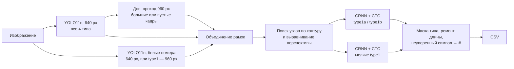

# Распознавание нестандартных ГРЗ — отчёт о решении

Полуфинал «Искусственный интеллект и анализ данных», задача «Распознавание нестандартных государственных регистрационных знаков». Отчёт построен по пунктам задания; в конце есть таблица «требование → раздел». Каждая цифра дана со ссылкой на файл, где она записана. Датасет в репозиторий не входит из-за размера: он лежит на [Google Drive](https://drive.google.com/drive/folders/1YMq7VnpGj-LJNcLBbss0RtCgfDtchrLs?usp=sharing) (`dataset_v8.zip`, папка `dataset/`).

## Итог

| Показатель | Значение | Источник |
|---|---|---|
| Новые номера, прочитаны целиком (тип + все символы) | **51 из 89 (57 %)** | [fin_test_report_v8.json](fin_test_report_v8.json) + [test22_report_v8_sub.json](test22_report_v8_sub.json) |
| `type1` / `type1a` / `type1b` на новых номерах | 9/14 · 29/53 · 13/22 | те же файлы |
| Номер `other` выдан как `type1` | 0 из 16 фото | [fin_test_report_v8.json](fin_test_report_v8.json) |
| Validation (по ней выбирались модели, оценка завышена) | 66 из 90: `type1a` 19/27, `type1b` 47/63 | [detection_variants_V6_2048.json](detection_variants_V6_2048.json) |
| Скорость, RTX 3060 | 22,5 мс в среднем, p95 48,5 мс | [fin_test_speed_v8.json](fin_test_speed_v8.json) |
| Скорость, GTX 1050 Ti + i5-7600 | **оценка** 55–85 мс в среднем | [speed_estimate_v8.json](speed_estimate_v8.json) |
| Датасет | 606 реальных + 5000 синтетических изображений | [dataset_validation_report.json](dataset_validation_report.json) |
| Работа | полностью офлайн, одна команда запуска | [run_final.ps1](run_final.ps1) |

«Новые номера» — две проверки, которые не использовались ни для обучения, ни для выбора моделей и порогов: fin_test (72 фото, 57 номеров) и test22 (32 фото квадратных номеров). Каждая запущена один раз после всех решений.

## 1. Что сдаётся

| Пункт задания | Где |
|---|---|
| Исходные тексты и обученные модели | [alpr/](alpr/), [models/](models/) (4 итоговые модели с `MODEL_PROVENANCE.json`) |
| Датасет со структурой из раздела 6 и отчётом валидатора | [Google Drive](https://drive.google.com/drive/folders/1YMq7VnpGj-LJNcLBbss0RtCgfDtchrLs?usp=sharing) (`dataset_v8.zip` → `dataset/`), `dataset/README.md`, [dataset_validation_report.json](dataset_validation_report.json) |
| Скрипты обучения и генерации синтетики | [alpr/train_yolo.py](alpr/train_yolo.py), [alpr/train_ocr_crops.py](alpr/train_ocr_crops.py), [alpr/train_ocr_synth.py](alpr/train_ocr_synth.py), [alpr/synth_crops.py](alpr/synth_crops.py), `dataset/generator/` |
| Инструкция и точная команда запуска | [README.md](README.md), раздел 9 этого отчёта |
| Пояснительная записка | [EXPLANATORY_NOTE.md](EXPLANATORY_NOTE.md) (4 страницы, PDF — `EXPLANATORY_NOTE.pdf`), подробности — [TECHNICAL_DETAILS.md](TECHNICAL_DETAILS.md) |

## 2. Источники данных

606 реальных изображений, 641 номер (`dataset/README.md`).

| Источник | Изображений | Права |
|---|---:|---|
| сообщества ВКонтакте | 261 | разрешения авторов на CC BY 4.0 (`dataset/evidence/`) |
| Wikimedia Commons | 106 | лицензия источника |
| Roboflow Universe (Russian License Plates Detector, RU ANRP) | 100 | CC BY 4.0 |
| Flickr | 86 | лицензия источника |
| собственные фото участника | 35 | собственные |
| busphoto.eu | 13 | указано в `meta.csv` |
| Unsplash | 5 | Unsplash License |

| | `type1` | `type1a` | `type1b` | `other` |
|---|---:|---:|---:|---:|
| Реальные изображения | 100 | 151 | 302 | 53 |
| Уникальные номера | 98 | 87 | 275 | 53 |
| Рекомендация задания (изобр. / уник.) | — | 150 / 50 | 300 / 100 | 50 |
| Синтетические номера | 900 | 1900 | 2082 | 323 |

Источник и лицензия каждого изображения записаны в `meta.csv` и `rights_provenance.json`. Отладочный набор организаторов в датасет не включён.

## 3. Методика сбора, разметки и генерации

**Сбор.** Поиск в открытых источниках с лицензией, допускающей некоммерческое использование, плюс собственная съёмка и разрешения авторов. Дубликаты убраны по SHA256 и перцептивному хешу.

**Разметка.** Рамка, четыре угла, тип, текст и `is_vehicle` размечены вручную и проверены глазами. Чужая модель для автоматической разметки не применялась.

**Разбиение.** 424 / 91 / 91 (train / val / test, [splits/real606.json](splits/real606.json)). Фото одного номера попадают только в одну часть. Все 100 реальных `type1` — только в train, поэтому независимой оценки `type1` на val нет.

**Синтетика (5000 изображений).** Строится только на обучающих фото: на место номера наносится новый текст по маске типа, перспектива и освещение исходного кадра сохраняются. Генератор воспроизводим: `python generator/generate.py ... --count 5000 --seed 20261023` (`dataset/README.md`). Для OCR дополнительно используется процедурная синтетика ([alpr/synth_crops.py](alpr/synth_crops.py)): номер рисуется целиком, ставится в случайную сцену с поворотом до 12° и перспективой, затем кадр портится экспозицией, тенью, смазом, шумом и JPEG.

**Приватность.** Лица на всех кадрах размыты ([blur_people.py](blur_people.py)), кадры, где человек — смысловой центр, не включались.

**Лицензии.** 407 реальных изображений под CC BY 4.0, 94 под CC BY 2.0, остальные — по лицензии источника. 59 фото (49 CC BY-SA, 5 Unsplash, 5 с разрешением автора только для проекта) перечислены в `dataset/license_exceptions.csv` и при необходимости исключаются вместе с 387 синтетическими кадрами на их основе. Код — MIT, Ultralytics YOLO11 и обученные на нём веса — AGPL-3.0.

## 4. Архитектура и её обоснование



- **Детекция — два YOLO11n.** Основной находит все четыре типа, второй дообучен на белых номерах и повышает полноту `type1`/`type1a`. Номера `other` распознаются как отдельный класс и в CSV не выводятся (задание это допускает), поэтому чужой номер не выдаётся как `type1`.
- **Дополнительный проход 960 px** на кадрах с длинной стороной ≥ 1600 px или без найденных рамок: на val он нашёл 6 из 12 пропущенных номеров ([detection_variants_V0.json](detection_variants_V0.json) → [detection_variants_V6_2048.json](detection_variants_V6_2048.json)). Для него загружается отдельная копия весов со своим CUDA graph: прогон тех же модулей на другом размере портил уже записанный граф 640 px.
- **Выравнивание.** Перед OCR ищется четырёхугольный контур номера и исправляется перспектива; квадратный номер разворачивается в строку «верх + низ».
- **OCR — небольшая CRNN с CTC.** Длина и маска задаются типом, поэтому одна модель читает и однострочные, и двухстрочные номера. Символ с уверенностью ниже 0.40 (для `type1` 0.5) заменяется на `#`, как в эталонной разметке.
- **Почему так.** Основная трудность задачи — мало реальных примеров редких типов, а не архитектура. Лёгкие модели (YOLO11n, CRNN) быстро дообучаются на сотнях фото и синтетике и укладываются в бюджет GTX 1050 Ti; тип номера отделён от чтения, поэтому новые форматы добавляются данными и маской, без смены пайплайна (раздел 12).

## 5. Обучение

- **Детекторы:** YOLO11n с весов COCO на 424 реальных фото train, 20 эпох, imgsz 640, AdamW ([alpr/train_yolo.py](alpr/train_yolo.py), `models/yolo11n_real_20261024/args.yaml`).
- **OCR:** сначала синтетика, затем реальные обрезки train ([alpr/train_ocr_crops.py](alpr/train_ocr_crops.py)); далее два раунда процедурной синтетики ([alpr/train_ocr_synth.py](alpr/train_ocr_synth.py)). Точность на реальных обрезках val: 50 % → 57 % → 67 % ([models/ocr_synth2_20261025/MODEL_PROVENANCE.json](models/ocr_synth2_20261025/MODEL_PROVENANCE.json)).
- **Выбор чекпойнтов и порогов** — только по val. Порог символа подобран перебором ([sweep_thresholds.py](sweep_thresholds.py), [sweep_thresholds2.json](sweep_thresholds2.json), [sweep_thresholds3.json](sweep_thresholds3.json)).

## 6. Качество

Метрика — номер считается верным, если на фото есть вывод с тем же текстом и тем же типом ([eval_fin_test.py](eval_fin_test.py)).

| Набор | `type1` | `type1a` | `type1b` | всего | other → не `type1` | Источник |
|---|---:|---:|---:|---:|---:|---|
| val, 91 фото (по нему выбирали) | — | 19/27 | 47/63 | 66/90 | 0 выдано как `type1` | [detection_variants_V6_2048.json](detection_variants_V6_2048.json) |
| fin_test, 72 новых фото | 9/14 | 11/21 | 13/22 | **33/57** | 16/16 | [fin_test_report_v8.json](fin_test_report_v8.json) |
| test22, 32 новых фото | — | 18/32 | — | **18/32** | нет в наборе | [test22_report_v8_sub.json](test22_report_v8_sub.json) |
| **новые вместе** | 9/14 | **29/53** | 13/22 | **51/89 (57 %)** | 16/16 | |

Честные оговорки:
- val использовался для выбора, поэтому 73 % на val — оптимистичная оценка; для новых фото ориентир 55–58 %.
- 89 номеров — небольшая выборка, разброс около ±10 %. В test22 23 разные машины, часть встречается на 2–4 фото.
- test22 собран участником, номера размечены глазами без запуска модели ([test22_labels.csv](test22_labels.csv)) и проверены дубликатами против датасета и fin_test.
- Ход версий на fin_test: 22 → 21 → 25 → 29 → 32 → 33 из 57 ([TECHNICAL_DETAILS.md](TECHNICAL_DETAILS.md), раздел 5).

## 7. Скорость и оборудование

| Оборудование | Среднее | p95 | Источник |
|---|---:|---:|---|
| RTX 3060, Intel Core 10-го поколения, 73 фото fin_test | 22,5 мс | 48,5 мс | [fin_test_speed_v8.json](fin_test_speed_v8.json) |
| GTX 1050 Ti + i5-7600 — **оценка, не замер** | 55–85 мс | ≈ 120–190 мс (грубо) | [speed_estimate_v8.json](speed_estimate_v8.json) |

В замер входят чтение, предобработка, модели, постобработка и запись CSV; загрузка моделей и прогрев — нет. Оценка для 1050 Ti: профайлер CUDA разделил время на 3060 на вычисления видеокарты (15,4 мс) и остальное (7,0 мс); первая часть умножена на 3–5, вторая на 1,2 ([estimate_speed.py](estimate_speed.py)). Перекрытие CPU и GPU не учитывалось — это оценка сверху. Видеопамять — до 750 МБ с CUDA graphs (пик по nvidia-smi на 91 фото val). Запасной режим `-NoGraphs` — около 67 мс на RTX 3060.

## 8. Соответствие требованиям к решению

| Требование | Как выполнено |
|---|---|
| Вход — каталог изображений, выход — CSV `image;plate_num;plate_type;confidence` | [alpr/infer.py](alpr/infer.py), UTF-8, разделитель `;`, неуверенные позиции `#` |
| Среднее ≤ 100 мс на референсной конфигурации | оценка 55–85 мс (раздел 7) |
| Локально и на сервере | Python-пакет без внешних сервисов, CPU (`-Device cpu`) или CUDA |
| Недорогое железо (i5-7600, GTX 1050 Ti 4 ГБ) | YOLO11n + CRNN, до 750 МБ видеопамяти |
| Полностью офлайн, веса в комплекте | `YOLO_OFFLINE=true`, веса в [models/](models/) |
| Типы 1, 1А, 1Б; расширяемость | раздел 6 и раздел 12 |
| Не выдавать номера вне ТС | частично: у YOLO нет признака «на ТС», см. раздел 11 |
| Данные допускают некоммерческое использование | раздел 3, `meta.csv`, `license_exceptions.csv` |

## 9. Запуск

```powershell
pip install -r requirements.txt
powershell -ExecutionPolicy Bypass -File .\run_final.ps1 -InputDir "<папка с фото>" -Output predictions.csv
```

Без NVIDIA: `-Device cpu`. Если CUDA graphs вызовут ошибку: `-NoGraphs`. Подробная установка — [README.md](README.md).

## 10. Структура репозитория

| Путь | Назначение |
|---|---|
| [alpr/](alpr/) | пайплайн, обучение, генерация, валидатор |
| [models/](models/) | итоговые веса с конфигурацией и происхождением |
| [run_final.ps1](run_final.ps1) | итоговый запуск |
| [tests/](tests/) | модульные тесты (`python -m unittest discover -s tests`) |
| [eval_fin_test.py](eval_fin_test.py), [label_fin_test.py](label_fin_test.py) | оценка и разметка независимых проверок |
| [analyze_val_errors.py](analyze_val_errors.py), [detection_variants.py](detection_variants.py), [diagnose_no_text.py](diagnose_no_text.py) | разбор ошибок и сравнение вариантов на val |
| [estimate_speed.py](estimate_speed.py), [profile_stages.py](profile_stages.py) | замеры скорости |
| `dataset/` ([Google Drive](https://drive.google.com/drive/folders/1YMq7VnpGj-LJNcLBbss0RtCgfDtchrLs?usp=sharing)) | датасет со структурой из задания |

## 11. Известные ограничения

- **Мелкие и сложные номера.** На новых фото основные ошибки — мелкие цифры региона в нижнем квадрате `type1a` (28 → 29, 790 → 730), первые буквы `type1b`, ночь, дым, сильный наклон; часть мелких номеров не находится ([test22_report_v8_sub.json](test22_report_v8_sub.json), [fin_test_report_v8.json](fin_test_report_v8.json)).
- **Признак «номер на ТС».** Запуск идёт с `--keep-nonvehicle`: номер на щите или витрине может попасть в вывод; негативных примеров вне ТС в данных почти нет.
- **`other`.** Транзитные, дипломатические номера и номера прицепов в данных есть лишь единично.
- **Мало реальных данных:** 424 фото для обучения. Добавление 927 сцен Roboflow с обычными номерами ухудшило результат (раздел 13).
- **Синтетика:** шрифт и геометрия приближённые, не сертифицированный ГОСТ.
- **Валидатор:** проверка выполнена локальным валидатором ([dataset_validation_report.json](dataset_validation_report.json)); совместимость с официальным `validate_dataset.py` нужно подтвердить.

## 12. Идеи по расширению на другие типы знаков

- **Новый формат = новая маска + данные.** Тип номера определяет длину и допустимые символы на позициях; для нового вида знака (транзитный, прицеп, мотоцикл, другая страна) добавляется класс детектора, маска и раскладка строк в `rectify`, без изменения пайплайна.
- **Синтетика под новый тип.** Генератор номера и процедурные обрезки параметризуются шрифтом, размером и цветом, поэтому для нового вида достаточно шаблона знака и нескольких десятков реальных фото для дообучения.
- **Другие страны.** OCR работает на CTC без фиксированной длины; алфавит расширяется добавлением символов и переобучением выходного слоя.
- **Признак «на ТС».** Отдельная лёгкая голова или классификатор контекста вокруг рамки на негативных примерах (щиты, витрины, экраны).

## 13. Что пробовали и отклонили

Сравнение на val с итоговой версией (66 верных из 90, 13 лишних выводов):

| Вариант | верно | лишних | other → `type1` | Источник |
|---|---:|---:|---:|---|
| CTC-поиск с маской номера | 63 | 28 | 1 | [detection_variants_V7.json](detection_variants_V7.json) |
| расширение обрезки 4 % / 8 % | 50 / 46 | 29 / 30 | 0 | [detection_variants_A1.json](detection_variants_A1.json), [detection_variants_A1b.json](detection_variants_A1b.json) |
| несколько обрезок на номер | 66 | 21 | 0 | [detection_variants_A2.json](detection_variants_A2.json) |
| третий раунд OCR | 62–64 | 16–18 | 0 | [detection_variants_V6_ocr3_c0.4.json](detection_variants_V6_ocr3_c0.4.json) |
| отдельный детектор для прохода 960 px | 63 | 20 | 0 | [detection_variants_B1.json](detection_variants_B1.json) |
| детектор, дообученный на 927 сценах Roboflow | 54 | 31 | 2 | [detection_variants_V6_rfdet.json](detection_variants_V6_rfdet.json) |

Возможности остались в коде как флаги, выключенные по умолчанию; сданный код на 91 фото val даёт побайтно тот же CSV, что и версия без них.

## 14. Воспроизводимость

- У каждой итоговой модели рядом лежат `MODEL_PROVENANCE.json` (команда обучения, данные, seed, критерий выбора) и `history.json`.
- Seed: генератор датасета 20261023, OCR 20261025, детекторы 42.
- Версии: Python 3.9.13, torch 2.7.1+cu118, ultralytics 8.4.163; точный список — [requirements-lock.txt](requirements-lock.txt); контрольные суммы — `SHA256SUMS.txt`.
- Архив сдачи проверен запуском из распакованной копии вне проекта.

## Таблица «требование → раздел»

| Требование задания | Раздел |
|---|---|
| Исходные тексты с обученными моделями | 1, 10 |
| Датасет по структуре раздела 6 с отчётом валидатора | 1, 2, 3, 11 |
| Скрипт обучения и скрипт генерации синтетики | 1, 3, 5 |
| Инструкция и точная команда запуска | 9 |
| Записка: источники данных | 2 |
| Записка: методика сбора и генерации | 3 |
| Записка: обоснование архитектуры | 4 |
| Записка: замеры скорости на своём железе | 7 |
| Записка: известные ограничения | 11 |
| Записка: идеи по расширению на другие типы | 12 |
| Требования 1–8 к решению (вход/выход, 100 мс, локально/сервер, железо, офлайн, типы, вне ТС, лицензии данных) | 8 |
| Правовые и этические требования к датасету (лицензии, лица, источники, без отладочного набора) | 2, 3 |
